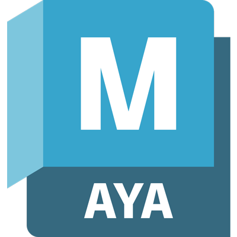

   <!--  -->
    

##

<!-- 

    

 -->

## 🚀 About Me

With a strong foundation in web development and a flair for 3D art and design, I enjoy building unique and engaging experiences.

## 🛠️ Tech Stack

### 💻 Programming, Web & Cloud Development

 
 
    
   
   
   
 <!--   
    
    
   
-->
   <!--  
    -->
   <!--     -->
   
   
    
   
   
  <!--  -->
    
   
   
   
   
    
    
 
 <!-- 
   
   
   
    

### 🎨 3D Art & Design

- 🎮 **Modeling:** Maya, Blender, ZBrush
- 🖌️ **Texturing & Shading:** Substance Painter, Photoshop
- 🦴 **Rigging & Animation:** Maya, Blender
- 🎥 **Rendering:** Unreal Engine
- 👕 **Cloth Simulation:** Marvelous Designer
-->

### 🔧 Additional Skills

- 🐧 **Operating Systems:** Linux (Debian/Fedora), VM (VMware/VirtualBox), servers configuration (DHCP, SSH,...)
- 🤖 **Artificial Intelligence:** I've created chatbots using custom LLMs and Vtube Studio to give them a 2D avatar but also using Unreal Engine 5 for 3D avatars.
- 🛠️ **APIs & Web Scraping:** I'm able to pull data from most APIs out there and scraping methods such as using Python and BeautifulSoup4 to retrieve the data.

## 📫 Connect With Me

    
    
    

---

💡 Let's connect and build something amazing together! 🚀

